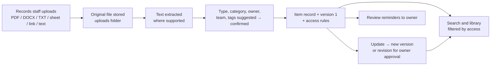

# Core flows — what the product must do first

Source of truth for priorities (2026-10-10). The product is built around **one learning loop** and **one
knowledge loop**. Everything else is secondary and must not get in their way.

> An employee joins, gets the skills their role needs, learns what HR assigns, finishes the lessons and
> the test, sees the result, and their progress is recorded. HR targets training at exactly the people it
> means. Separately, company knowledge is uploaded, organised, searched and kept up to date safely.

Single company (no multi-tenant), see `docs/prd.md`. Plain words in the UI: "test", "course", "lesson",
"learning plan", "stage". Internal names in code may differ (e.g. `wave` = stage, `assessment` = test).

---

## A. Flows

### A1. Learning loop

```mermaid
flowchart LR
  R[Employee signs up<br/>or HR uploads them] --> J[Picks job role]
  J --> S[Role skills appear<br/>on profile]
  H[HR picks a skill] --> M{Who?}
  M -->|Auto| A1[Everyone whose role<br/>needs the skill]
  M -->|Manual| A2[Search by name, role,<br/>department, skill]
  A1 --> P[Preview: skill, course,<br/>people, due date, test]
  A2 --> P
  P -->|Confirm| X[One assignment per person<br/>duplicates skipped]
  X --> N[Notify only those people]
  N --> D[Employee home: assigned training]
  D --> C[Course → lessons<br/>progress saved]
  C --> T[Test: score, pass/fail,<br/>attempt stored]
  T --> L[Records: course done,<br/>test passed, skill level]
  L --> HR[HR tracker: not started · in progress ·<br/>course done · passed · failed · overdue]
  S -.-> H
```

### A2. Knowledge loop

Uploading to the Hub **never** creates training. Turning a document into a course is an explicit action
("Turn into a course"), done by a learning admin.

### A3. Automation (what runs by itself)

Runs in the **worker** (`uv run python -m app.worker`): it consumes the job queues and ticks the scheduler
(every `LMS_SCHEDULER_INTERVAL_SECONDS`, default 300 s). Daily tasks run once a day after 08:00 local time;
admins can run them by hand (Message log → "Run today's automations now").

| Automation | When | Who gets it | Source |
|---|---|---|---|
| Assignment notice | When HR confirms an assignment | Only the selected people | LMS.pdf Training Assignment |
| Due-date reminders | 7 days, 2 days and on the due date (`reminders.due_stages_days`) | The person, in their best time | LMS.pdf Training Reminder |
| Daily completion nudge | Weekdays, max 1/day, 3/week | People with unfinished items | sheet 12 |
| Stop on completion | Checked again at delivery | — | LMS.pdf step 4 |
| Overdue list after the deadline | Day after a due date | Each manager, one list | LMS.pdf step 5 |
| Weekly overdue summary | Mondays | Each manager | sheet 03 |
| Test result + feedback | Right after submitting | The person | LMS.pdf Assessment step 4 |
| Results summary | Every morning, yesterday's tests | Managers (their team) + HR admins (all) | LMS.pdf Assessment step 5 |
| Certificate renewal | 60/30/7 days before expiry | The holder | sheet 09 |
| Session invitations | When a session is scheduled (hybrid) | The audience | sheet 12 |
| Knowledge review ladder | Daily | Item owners, then up the ladder | sheet 14 |

**Channels.** In-app messages are real. **Email and WhatsApp are simulated** until a provider is connected:
the full message (to, subject, text, link) is written to `delivery_logs` and shown on **Admin → Message log**,
and nothing leaves the system. A person's channel choices (My reminders) are respected; WhatsApp needs a phone
number. Connecting a real provider = one channel class with the same key (`notifications/channels.py`).
The "Stop all automatic sends" switch pauses every automatic message.

### A4. Helpers (the "AI Agent" steps of LMS.pdf)

Admin → **Helpers** (`/admin/helpers`). Each run is an `agent_runs` row with its steps; the page shows every
step live (what it read, what it wrote, what it removed) and the run waits for a person where LMS.pdf says a human decides.

| LMS.pdf process | Helper does (steps shown) | Person does |
|---|---|---|
| Course Creation | read the brief → find company material (published, company-wide Knowledge Hub items) → plan modules with outcomes → write each module with an example → add links → write the quick check → check the draft → try it as a learner | HR gives topic, audience, goal, length; the **expert approves** before it is published |
| Quiz / Assessment Creation | read lessons and goals → draft ~10 questions (multiple choice + written cases with model answer and rubric) → set pass mark and time → remove broken/repeated questions → save → try it once | the **expert approves** the questions (a live course goes back to review) |
| Training Assignment | read the plain-words request (course, who, date; usual period from `learning.default_due_days` if none) → show the full list | HR **confirms**; then the helper assigns, sends the notice, checks it shows for everyone, records it in the tracker (undo for 10 minutes) |
| Assessment / Evaluation | written answers scored against the rubric at submit | if the score is unsure (`learning.written_review_below`), the **course expert or an admin** confirms the marks on *Answers to check*; the result is held until then |
| Training Reminder | already automatic (A3) | — |

The helpers use the assistant service (Groq, or the offline rules when Groq is not set or fails) and work fully offline.
A failed step is shown with a plain reason; the course is never left half-made or published.

---

## B. Data model (what exists, what it is for)

Essential for the MVP loops are marked **M**; the rest supports later features and stays as built.

| Area | Tables | MVP | Notes |
|---|---|---|---|
| People | `users`, `departments` | M | `job_role_id` is the designation. `system_roles` holds access roles. `manager_id` for team views. |
| Roles & skills | `job_roles`, `skills`, `role_skills` (required level) | M | The role library. Changing a user's role changes which skills are *required*; history stays. |
| Skill levels | `skill_levels` (current level, score, assessed_at) | M | Only tests (or an audited admin override) change a level. Finishing a course does not. |
| Courses | `courses` (skill, level from→to, pass mark), `lessons`, `course_questions` | M | A course teaches one main skill. |
| Training | `assignments` (user, course, due, status, progress, mandatory, source, batch) | M | One active assignment per person per course (duplicates skipped). |
| Progress | `lesson_progress` | M | Resume where you stopped. |
| Course test attempts | `course_quiz_attempts` (answers, score, passed, attempt no.) | M | Every attempt kept, never overwritten. Tries limited by setting. |
| Skill tests | `skill_tests`, `test_questions`, `test_attempts`, `test_invites`, `proctor_events` | M | Level-setting tests ("skill checks"), with optional supervision. |
| Bulk safety | `bulk_actions` | M | Preview + undo for 10 minutes. |
| Notifications | `notifications`, `delivery_logs`, delivery via queue | M | Only selected people. One log row per channel; email/WhatsApp simulated until a provider is connected. |
| Audit | `audit_logs` | M | Assignments, role changes, overrides, exports, approvals. |
| Settings | `app_settings` | M | Every business number (pass mark, tries, reminders). |
| Knowledge | `knowledge_items` (current), `knowledge_versions`, `knowledge_revisions`, `knowledge_reviews`, `knowledge_access`, `knowledge_categories`, `knowledge_uploads`, `knowledge_list_rows`, `knowledge_access_requests` | M | Item record is small; text per version; files separate; access rules separate. |
| Pathways | `pathways`, `pathway_items` | V2 | Personal learning plan from gaps. Built; not required for the HR loop. |
| Certificates | `certificates` | V2 | Built. |
| Sessions | `live_sessions`, `invitations` | V2 | Built. |
| Gamification | `point_entries`, `badges`, `user_badges`, `challenges`, `leaderboard_snapshots` | V2 | Built; kept light. |
| Career | `career_moves` | V3 | Built. |
| Workflows, reports | `workflows`, `workflow_runs`, `report_schedules` | V2 | Built (7 workflows, 15 reports). Not expanded until the loops are solid. |

---

## C. Permissions

Access roles: **Employee** (`learner`), **Manager**, **HR admin** (`admin`), **Course expert** (`expert`),
**Knowledge admin** (`knowledge_admin`), **Function head**. All checks are on the server.

| What | Employee | Manager | HR admin | Course expert | Knowledge admin |
|---|---|---|---|---|---|
| Own profile, skills, assignments, results | view | view | view | view | view |
| Other people's results / progress | – | own team | all | – | – |
| Sign up and pick a role | yes (if allowed in settings) | – | edit anyone's role | – | – |
| Roles & required skills | view own | view | create / edit | view | – |
| Courses | take | take | create / edit / publish | draft / review | – |
| Assign training (by skill or people) | – | – | create / undo | – | – |
| HR tracker, reminders, exports | – | own team (view) | all | – | – |
| Skill level override | – | – | yes, audited | – | – |
| Knowledge Hub: open | – (unless owner) | yes | yes | – (unless owner) | yes |
| Knowledge: add / update | owner/editor of item | owner/editor | yes | owner/editor | yes |
| Knowledge: publish / verify / access rules | item owner | item owner | yes | item owner | yes |
| Knowledge: categories, without-owner list | – | – | yes | – | yes |
| Restricted (team / named) items | – | only if granted | yes | – | yes |

---

## D. MVP / V2 / V3

| Feature | Class | Why |
|---|---|---|
| Sign-up with role → skills on profile | **MVP** | Start of the loop. |
| Role library (skills + required levels) | **MVP** | Drives skills and auto-targeting. |
| Assign by skill (auto) or by people (manual), preview, confirm, no duplicates | **MVP** | HR's main job. |
| Targeted notifications + reminders that stop on completion | **MVP** | Without it nobody starts. |
| Course → lessons → test → result, progress saved, attempts kept, tries limited | **MVP** | The learning itself. |
| Separate states: assigned · in progress · course done · test passed · level proven | **MVP** | Honest progress. |
| HR tracker per course + overdue + reminder + CSV export | **MVP** | HR must see who is where. |
| Knowledge upload, categorise, search with access, versions | **MVP** | The second module. |
| Skill tests that set levels (with supervision option) | **MVP (simple)** | Levels must come from tests. Camera supervision only for mandatory tests. |
| Learning plan (stages from gaps) | V2 | Useful, built; not needed for HR assignment. |
| Certificates with QR verify | V2 | Built; mandatory-training proof. |
| Live sessions & invitations | V2 | Built. |
| Workflows (auto/hybrid) beyond reminders | V2 | Built for 7 cases; expand later. |
| Reports beyond the tracker (15 built) | V2 | Spec lists 32; add on demand. |
| Points, badges, leaderboards | V2 | Built; motivation, not core. |
| Draft a course from a document (assistant) | V2 | Works without the assistant (rules fallback); expert approves. |
| Helpers: course from a brief, quiz writer, assign from a request (A4) | V2 | Built; every step shown, a person approves. |
| Rubric scoring of written answers | V2 | Built; unsure scores go to the course expert before they count. |
| Career map | V3 | Built; depends on a full role library. |
| AR, generated video, advanced proctoring | V3 | Expensive; simple modes exist. |
| Ask-the-Hub answers | V3 | Works on verified items only; search is the MVP. |

Nothing built is deleted. V2/V3 features stay but are not extended until the MVP loops pass the tests below.

---

## E. Acceptance tests (backend, `test/backend/core_flows/`)

| # | Behaviour | Test |
|---|---|---|
| 1 | An employee signs up and picks a role | `test_signup_with_role_shows_role_skills` |
| 2 | Their role's skills appear on the profile with separate states | same + `test_skill_states_are_separate` |
| 3 | HR picks a skill and previews matching employees | `test_assign_by_skill_previews_people_whose_role_needs_it` |
| 4 | HR adds a different employee by hand for the same skill | `test_manual_people_are_added_to_skill_audience` |
| 5 | Only the intended employees are notified | `test_only_selected_people_are_notified` |
| 6 | Employees open their assigned course and lessons | `test_assigned_course_shows_on_home_and_opens` |
| 7 | Progress persists | `test_progress_is_saved_between_sessions` |
| 8 | Test submissions are scored correctly and every attempt is stored | `test_attempts_are_kept_and_scored` |
| 9 | Course done and test passed are separate states | `test_course_done_and_test_passed_are_separate` |
| 10 | HR sees each person's state | `test_hr_tracker_counts_each_state` |
| 11–13 | Knowledge upload, search with access, versions | `test/backend/knowledge/*` |
| 14 | Unauthorised users are refused | `test_employees_cannot_see_others_or_assign`, knowledge access tests |
| + | Repeating an assignment creates no duplicates | `test_repeat_assignment_creates_no_duplicates` |
| + | Role change keeps history and changes required skills | `test_role_change_keeps_history` |
| + | Retakes respect the setting | `test/backend/learning/test_courses_and_player.py` |
| + | A failed channel does not lose the notification | `test/backend/notifications/*` |
